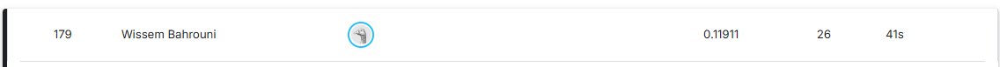

# House Prices: Advanced Regression Techniques

My solution to Kaggle's [House Prices](https://www.kaggle.com/competitions/house-prices-advanced-regression-techniques) competition: predicting home sale prices from 79 property features, using feature engineering and a weighted blend of 8 regression models.

**Author:** Wissem Bahrouni

## Result

| Leaderboard score | Rank | Submissions |
| --- | --- | --- |
| **0.11911** | **179** | 26 |

The score is the RMSE between the logs of predicted and actual prices, where lower is better. It corresponds to a typical error of roughly 12%. The rank is from the screenshot above and can change as the leaderboard moves.

## Approach

1. **Outliers:** removed 3 training houses using two common rules, which leaves 1,457 houses.
2. **Target:** modeled `log1p(SalePrice)`.
3. **Missing values:** filled according to meaning, such as "None" for a missing garage, 0 for its area, and the neighborhood median for `LotFrontage`.
4. **Feature engineering:** added total area, bathrooms, ages, presence flags, ratios, quality interactions and a luxury score.
5. **Encoding:** used ordinal maps for ranked categories, smoothed target encoding for 7 categorical features, and one-hot encoding for the rest.
6. **Skew and selection:** applied Box-Cox to skewed features and removed near-constant ones, leaving 188 features.
7. **Blending:** trained 8 models with 10-fold cross-validation, then optimized blend weights on their out-of-fold predictions using Nelder-Mead.

## Models

| Model | CV RMSE | Out-of-fold RMSE | Blend weight |
| --- | --- | --- | --- |
| Ridge | 0.10983 ± 0.01270 | 0.11058 | 52.6% |
| ElasticNet | 0.10995 ± 0.01276 | 0.11071 | 7.8% |
| Lasso | 0.11067 ± 0.01238 | 0.11138 | 0.0% |
| GBR | 0.11268 ± 0.01434 | 0.11363 | 28.9% |
| CatBoost | 0.11416 ± 0.01336 | 0.11497 | 9.5% |
| XGBoost | 0.11552 ± 0.01220 | 0.11619 | 0.0% |
| LightGBM | 0.11803 ± 0.01459 | 0.11896 | 0.5% |
| RF | 0.12850 ± 0.01131 | 0.12902 | 0.7% |

The blend's out-of-fold RMSE is **0.10837**. Ridge and Gradient Boosting carry most of the weight, and simple regularized linear models beat every tree-based model individually on this feature set.

## Cross-validation vs leaderboard

The blend scores 0.1084 in cross-validation but 0.1191 on the leaderboard, so the local score is optimistic. These parts of the pipeline probably contribute:

- **Target encoding:** it's computed on all training rows before cross-validation, so each validation fold has influenced its own features.
- **Blend weights:** they're tuned on the same out-of-fold predictions used to report the blend's score.
- **Outliers:** the removed houses are never part of validation, but similar cases can appear in the test set.

## Run it

The notebook is set up for Kaggle, and the competition data isn't included in this repo.

- **On Kaggle:** create a notebook in the competition, upload `house_prices_blending.ipynb` and run all cells. It writes `submission.csv`.
- **Locally:** run `pip install -r requirements.txt`, download the data from the competition page, then change the two `read_csv` paths at the top of the notebook.

## Tech stack

Python, pandas, NumPy, SciPy, scikit-learn, XGBoost, LightGBM, CatBoost, Matplotlib
